<div align="center">

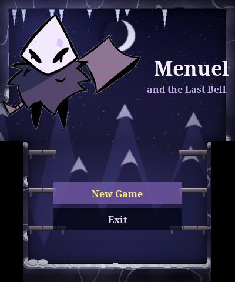

# Menuel and the Last Bell

**Natywna metroidvania na New 2DS XL / 3DS, napisana w C od zera**


</div>

Dzwony Podziemnego Miasta umilkły, a wraz z nimi jego mieszkańcy zapominają, kim są.
W zakurzonym lofcie budzi się Menuel, mały strażnik w masce w kształcie latawca.
Bierze topór, schodzi w dół i po kolei budzi cztery dzwony, aż dociera do tego, kto je uciszył.

**40 pokoi na dwa ekrany · 4 krainy · 5 bossów · 4 zdolności · 4 odłamki zdrowia · osełka · 9 utworów · zapis przy latarniach.**
Każdy pokój obejmuje oba ekrany: Menuel skacze i spada z górnego na dolny, a bossowie atakują przez oba. Tekst w grze jest po angielsku. To nie jest ROM do emulatora: gra działa bezpośrednio na konsoli.

| Eksploracja na dwóch ekranach | Hak nad Hanging Bells |
|:-:|:-:|
| 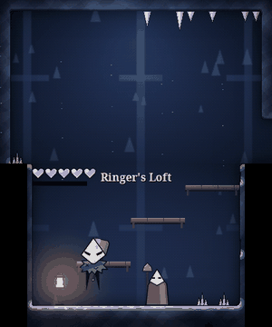 | 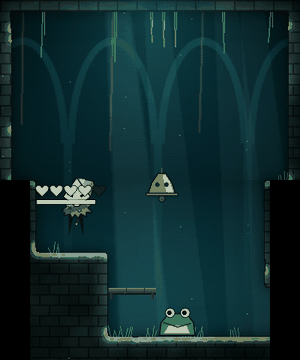 |

| Rope Drowned spada z góry | Silent Ringer |
|:-:|:-:|
| 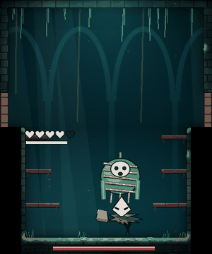 | 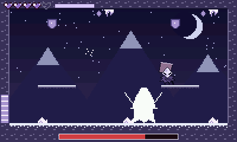 |

## Pobierz i zainstaluj

Konsola musi mieć custom firmware (np. Luma3DS). Pliki są w [`release/`](release/) oraz w [Releases](../../releases).

| Plik | Jak użyć |
|---|---|
| [`Menuel.cia`](release/Menuel.cia) | Skopiuj na kartę SD i zainstaluj w FBI. Gra pojawi się na ekranie HOME. |
| [`Menuel.3dsx`](release/Menuel.3dsx) | Skopiuj do `/3ds/Menuel/` i uruchom z Homebrew Launchera. |

- **Zapis:** `sdmc:/3ds/Menuel/save.bin`. Obie wersje korzystają z tego samego pliku.
- **Dźwięk:** wymaga `/3ds/dspfirm.cdc`. Bez tego pliku gra działa, tylko bez dźwięku.

## Sterowanie

| Przycisk | Akcja |
|---|---|
| ←/→ lub Circle Pad | ruch |
| **A** | skok (przytrzymaj = wyżej), drugi skok z Cloak |
| **B** | topór |
| **R** | Rush, czyli zryw |
| **L** lub dotknięcie pierścienia na dolnym ekranie | Hook, z wciśniętym kierunkiem wybiera pierścień po tej stronie |
| **↓ + B** w powietrzu | Cleave, czyli cios w dół, który kruszy spękane podłogi |
| **X** (przytrzymaj na ziemi) | zamienia echo na zdrowie |
| **↓** | zeskok z cienkiej platformy |
| **↑** | rozmowa, tablica, latarnia (zapis i leczenie) |
| **START** | pauza, mapa i ekwipunek na dolnym ekranie |
| **SELECT** | licznik wydajności na dolnym ekranie |

## Świat

| Kraina | Pokoje | Zdolność | Boss |
|---|---|---|---|
| Salt Mines | 10 | Rush | Salt Foreman |
| Drowned Belfry | 11 | Hook | Rope Drowned |
| Rust Foundry | 11 | Cleave | Two-Headed Founder, The Anvil |
| Summit of Silence | 8 | Cloak | Silent Ringer |

Górny ekran pokazuje pełną szerokość pokoju, a dolny jego niższą część. Serca podążają za Menuelem na ekran, na którym jest, a dialogi pojawiają się na tym drugim, żeby niczego nie zasłaniać. Przycisk START wyświetla na dolnym ekranie mapę odwiedzonych pokoi, latarnie, bossów, zdolności i dzwony.

## Zrzuty ekranu

| | | |
|:-:|:-:|:-:|
| 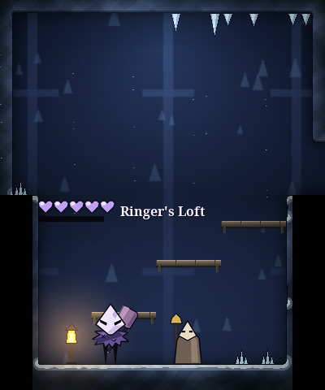 | 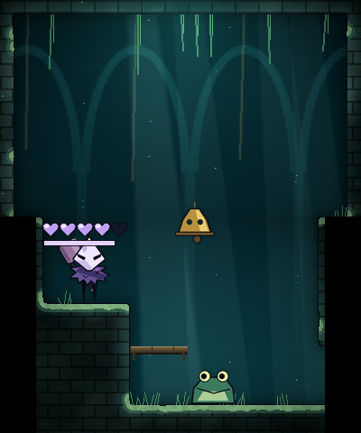 | 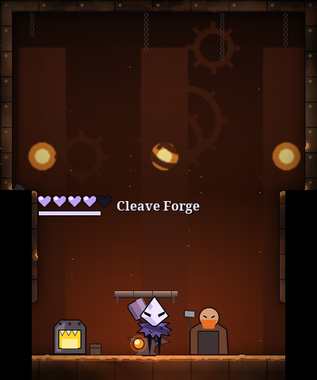 |
| Ringer's Loft | Drowned Belfry | Rust Foundry |
| 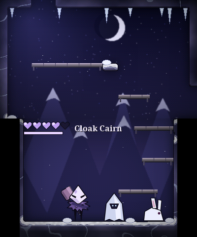 | 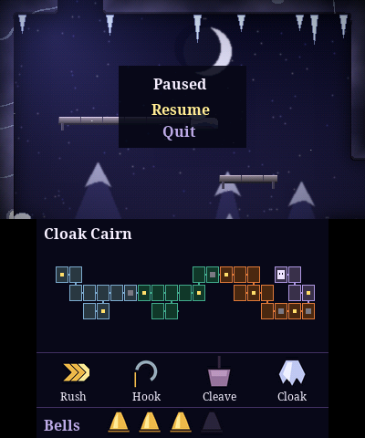 | 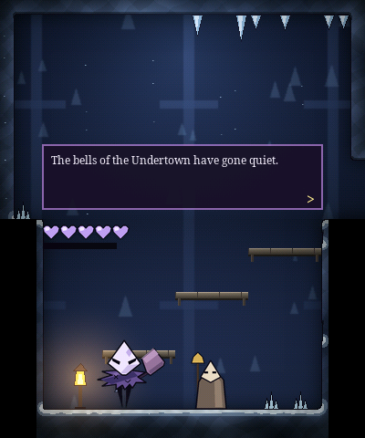 |
| Summit of Silence | Pauza i mapa | Dialog na wolnym ekranie |
| 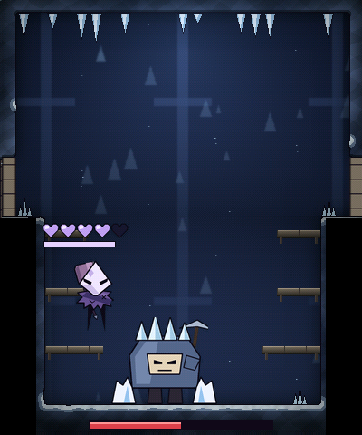 | 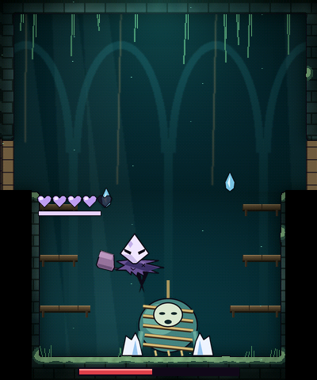 | 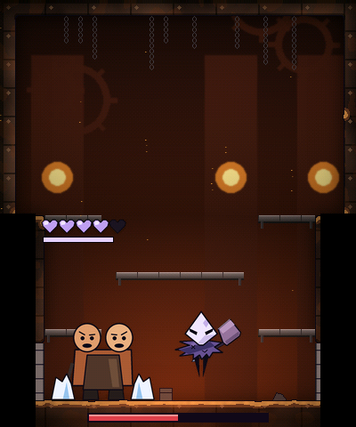 |
| Salt Foreman | Rope Drowned | Two-Headed Founder |
| 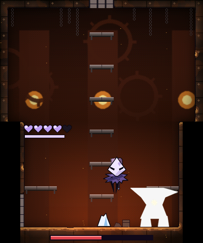 | 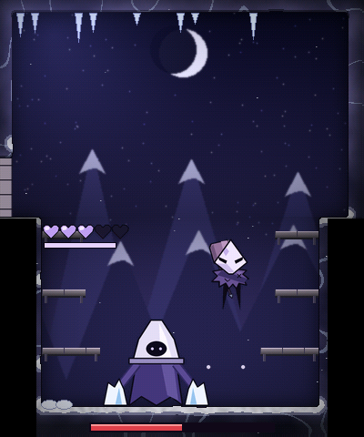 | 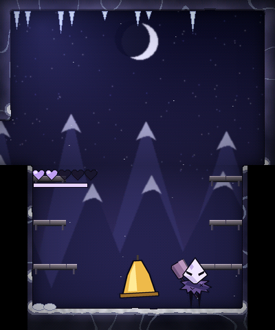 |
| The Anvil | Silent Ringer | Ostatni dzwon |

## Budowanie

Wymagane: Python 3 w `.venv`, czcionki Noto Serif, gcc, podman (kompilator devkitARM działa w kontenerze) oraz `gh` do pobrania `makerom` i `bannertool`.

```sh
python3 -m venv .venv && .venv/bin/python -m pip install pillow numpy scipy lz4
make                            # assety i biblioteka testowa
make 3ds                        # build/Menuel.3dsx i build/Menuel.cia
.venv/bin/python tests/t_full.py   # pełne przejście gry
```

## Jak to działa

Cała gra to zwykły C bez zależności od sprzętu. Rysuje programowo do buforów RGB565 z półprzezroczystością, a warstwa konsoli tylko je wyświetla, czyta przyciski i ekran dotykowy i gra dźwięk przez NDSP. Dzięki temu te same piksele powstają na konsoli i w testach.

```
assets/  art.py (postacie), bake.py (malowane tła), world.py (pokoje i teksty), music.py, build.py
src/     game.c, player.c, enemy.c, boss.c, render.c, audio.c
         plat_3ds.c (konsola), host.c (biblioteka do testów)
tests/   t_world, t_boss, t_full, t_misc, make_media
tools/   budowanie .3dsx i .cia
docs/    spec.md, rysunek Menuela, zrzuty i gify
```

Postacie są rysowane wektorowo z grubym konturem, w dużym rozmiarze, a następnie zmniejszane do klatek z gładkimi krawędziami. Ruch powstaje przez przesuwanie i obracanie części ciała. Każdy pokój jest malowany przy budowaniu (tekstury, światło, cienie, dekoracje) i przechowywany w postaci skompresowanej LZ4. Muzyka też powstaje ze skryptu. Ilustracja na ekranie tytułowym i ikona pochodzą z rysunku Menuela (`docs/menuel-reference.png`).

## Testy

Bot steruje grą tymi samymi przyciskami co gracz i korzysta z prawdziwej fizyki.

- **`t_world`** przeszukuje stany gry i sprawdza, że każdy cel i każdy przedmiot jest osiągalny w zaplanowanej kolejności, a bez danej zdolności nie da się ominąć jej blokady.
- **`t_boss`** walczy z każdym bossem przy zwykłych obrażeniach. Bot przewiduje ruchy dzięki migawkom stanu gry, więc jest sprawniejszy od człowieka.
- **`t_full`** przechodzi grę od ekranu tytułowego do napisów. Wrogowie są nieszkodliwi tylko na trasie między celami, bossowie zadają normalne obrażenia.
- **`t_misc`** sprawdza śmierć, zapis po restarcie, pauzę, dźwięk i renderowanie wszystkich pokoi.

- **`tests/fuzz.c`** gra losowymi przyciskami we wszystkich pokojach pod ASan i UBSan, sprawdza utknięcia w ścianach, wyjście poza ekran i uszkodzone pliki zapisu.

`.3dsx` i instalacja `.cia` zostały sprawdzone w emulatorze Azahar. Gra nie była jeszcze uruchamiana na fizycznej konsoli, więc wydajność i dźwięk na sprzęcie są niepotwierdzone.

## Wydajność

Pomiar kodu ARM w emulatorze Azahar, 240 klatek w każdym z 40 pokoi, budżet klatki to 16,67 ms. Pełny wynik: [`docs/perf-azahar.txt`](docs/perf-azahar.txt).

| Co | Średnio | Najwięcej |
|---|---:|---:|
| Logika i rysowanie | 3,0 ms | ok. 21 ms (rozpakowanie pokoju, w czasie wygaszenia ekranu) |
| Kopiowanie na oba ekrany | 3,4 ms | 3,4 ms |
| Dźwięk | 0,4 ms | 1,5 ms |
| Zapis na kartę (tylko latarnia i przedmioty) | | ok. 90 ms |

Emulator nie odwzorowuje dokładnie czasów pamięci i karty SD, więc to szacunek, a nie wynik ze sprzętu. Na konsoli **SELECT** pokazuje na dolnym ekranie `logika/cała klatka max najgorsza late liczba spóźnionych klatek` w milisekundach. Wynik nad 16,6 ms oznacza spóźnioną klatkę.

Fuzz (600 tys. klatek): 0 błędów pamięci, 0 klatek w ścianie, 0 wyjść poza ekran i 0 z 28 uszkodzonych zapisów przyjętych przez grę.
